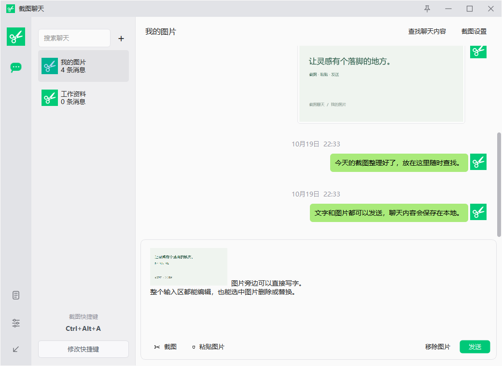

# 截图聊天

微信风格的 Windows 本地截图、文字与图片记录工具。无需账号，聊天与图片保存在本机。

**版本 1.2.1 · Windows 10/11 x64 · MIT**

[下载最新版本](https://github.com/DTyun/screenshot-chat/releases/latest) · [作者 X：@yumi202607](https://x.com/yumi202607) · [更新记录](CHANGELOG.md)



## 下载与运行

在 [Releases](https://github.com/DTyun/screenshot-chat/releases/latest) 下载 `ScreenshotChat-v1.2.1-win64.zip`，解压后双击 **截图聊天.exe**，无需安装 Python。也可下载单文件 EXE；许可材料同时嵌入程序。

升级前先从托盘退出旧版。历史记录默认保存在用户目录，替换程序不会删除聊天。

## 功能

- 自定义全局截图快捷键，默认 **Ctrl+Alt+A**。
- 框选后标注：矩形、圆形、箭头、画笔、文字、马赛克，支持颜色、粗细、撤销和保存。
- 可编辑的图文输入框；发送文字、多张图片及图片备注。
- 文件消息：复制文件后 Ctrl+V、从文件夹拖入，或点击“文件”选择；发送后双击用系统默认程序打开。
- 多个本地聊天，可新建、重命名、确认删除；按文字、图片、日期查找并定位。
- 图片双击用内置只读窗口查看，支持缩放和拖动。
- 图片和文字右键复制、删除；删除聊天时确认后同时删除文字、原图和缩略图。
- 已发送文字及图片备注可拖选部分内容，Ctrl+C 或右键复制所选文字，也可复制全文；双击文字选词。
- 消息列表以较小距离平滑滚动，方便逐条阅读；长消息不会导致滚轮突然跳过大段内容。
- 托盘常驻、单实例、开机启动勾选、窗口置顶、最大化与圆角。
- 自选缓存文件夹，默认迁移原记录，也可不迁移。
- “关于软件”显示版本、X 账号链接和开源信息。
- 启动后后台检查 GitHub 正式版本，有新版时提示；“关于软件”也可手动检查并打开官方版本页下载。
- 左下侧栏“查看日志”：查看运行与错误记录、刷新、复制或打开文件夹。

## 使用

[查看文件消息界面示例](docs/images/files.png)

1. 按截图快捷键框选屏幕，松开后出现标注工具栏。点击 **✓ / Enter** 完成，会复制图片并打开聊天，将截图插入输入框；按 **Esc** 取消。
2. 直接输入文字，或 **Ctrl+V** 粘贴图片。文字与图片共用整个输入区，可选择、删除、替换、撤销；支持连续粘贴多张图。
3. **Enter / Ctrl+Enter** 发送，**Shift+Enter** 换行。发送将原图和文字保存到当前本地聊天。
   文件也可和文字、图片混排发送。软件会复制文件到缓存，保留原名和内容；之后原文件移动或删除也不影响已保存副本。文件夹不作为附件发送。
4. 点击左上 **＋** 新建聊天。右键聊天可重命名或删除；删除会先弹窗确认，无法撤销。删除最后一个聊天会新建空的“我的图片”。
5. 点击 **查找聊天内容** 搜索当前聊天，并定位到消息。不包含图片 OCR。
6. 在 **截图设置** 修改快捷键、开机启动和缓存文件夹。设置窗口左下可进入 **关于软件**，也可通过托盘右键进入。
7. **关于软件 → 检查更新** 可查看新版说明并点击 **下载更新**。下载后从托盘退出旧版，再替换 EXE 或解压到新目录运行；继续使用原缓存即可保留聊天。

关闭、最小化或收起按钮会进入右下角托盘；托盘右键 **退出截图聊天** 才真正退出。重复运行只唤起已有窗口。

“发送”仅保存到本机，不发送给微信好友或网络服务。退出程序后未发送草稿不保留。

从 1.2.0 起，启动 5 秒后向 GitHub 公共 Releases API 检查一次版本，只读取正式发布版本，不发送聊天内容或本地文件，也不需要 GitHub 账号。断网检查失败不弹窗；截图、文件保存或其他弹窗期间延后提示，托盘运行时通过托盘通知。下载更新按钮打开浏览器中的官方版本页，由用户下载并替换程序。

维护者发布新版时，先提高 `src/version.py` 中的三段版本号，构建并上传 EXE / ZIP 到对应 `v版本号` 的 GitHub Release，发布为正式版本并设为 Latest。只推送源码、创建标签或保存草稿不会触发提示。1.1.0 及更早版本需先手动下载一次 1.2.0，之后才具备更新检查功能。

## 数据与备份

默认目录为 `%LOCALAPPDATA%\Pianyu`，沿用原目录名以兼容早期版本。

| 内容 | 文件/目录 |
|---|---|
| 原图 | `images/` |
| 缩略图 | `thumbnails/` |
| 文件消息副本 | `files/`，按唯一目录保存原文件名，重名不覆盖 |
| 消息与聊天索引 | `history.db` |
| 设置 | `settings.json` |
| 运行与错误日志 | `app.log`，及轮转备份 `app.log.1`、`app.log.2` |
| 缓存位置指针 | 默认目录下的 `location.json` |

更改缓存位置时默认复制并校验记录与图片，旧目录保留备份；目标应为空。选择不迁移会使用目标已有记录或建立空库。迁移失败保留旧库。

备份时先退出程序，再复制整个当前缓存目录。仓库和发行包不包含用户聊天或截图缓存。

删除文件消息或整个聊天时会确认，只删除软件的缓存副本，不删除外部原文件。修改缓存位置并迁移时会一并复制文件附件。

设置按钮上方的文档图标可打开内置日志窗口。日志仅供本地排错，不主动写入聊天正文或图片内容；每个日志文件最大约 2MB，保留两个备份。大文件窗口只显示最近 512KB，完整文件可通过“打开文件夹”查看。

## 源码运行与构建

使用 Windows x64、Python 3.13、PowerShell：

```powershell
git clone https://github.com/DTyun/screenshot-chat.git
cd screenshot-chat
python -m venv .venv
./.venv/Scripts/python.exe -m pip install -r requirements-dev.txt
./.venv/Scripts/python.exe main.py
```

生成独立 EXE（版本号统一维护于 `src/version.py`）：

```powershell
./build.ps1
```

输出 `dist/截图聊天.exe`。构建脚本会生成 Windows 版本元数据，并内置项目协议和第三方许可。`hooks/` 排除未使用的 PDF 与虚拟键盘插件。

```powershell
./.venv/Scripts/python.exe -m pytest -q
./.venv/Scripts/python.exe tests/render_preview.py
```

`desktop_smoke.py` 和 `packaged_smoke.py` 会打开测试窗口、写入剪贴板或启动程序，运行前应退出正式程序。测试使用独立的 `artifacts/test-data/`，不修改正式聊天。

## 许可与依赖

项目代码和自制图标使用 [MIT License](LICENSE)，Copyright (c) 2026 yumi202607。

依赖 Python、Qt、PySide6 和 Shiboken，分别保留原许可；详见 [第三方组件说明](THIRD_PARTY_NOTICES.md) 和 `licenses/`。同一 Release 提供对应 Qt / PySide 源代码包和替换共享库的构建说明。

## 范围与限制

本地工具，不提供账号、联系人、云同步、OCR 或联网聊天。单次选区位于一个显示器内，不提供跨屏拼接。混合 DPI、多屏 HDR 和另一台干净 Windows 设备尚未完成验证。

最初参考调研：[PathSnip](https://github.com/mcheiyue/PathSnip)、[MiniSnip](https://github.com/Mirochill/MiniSnip)、[WinShot](https://github.com/mrgoonie/winshot)。本项目独立实现，没有复制这些项目的代码或微信商标。
